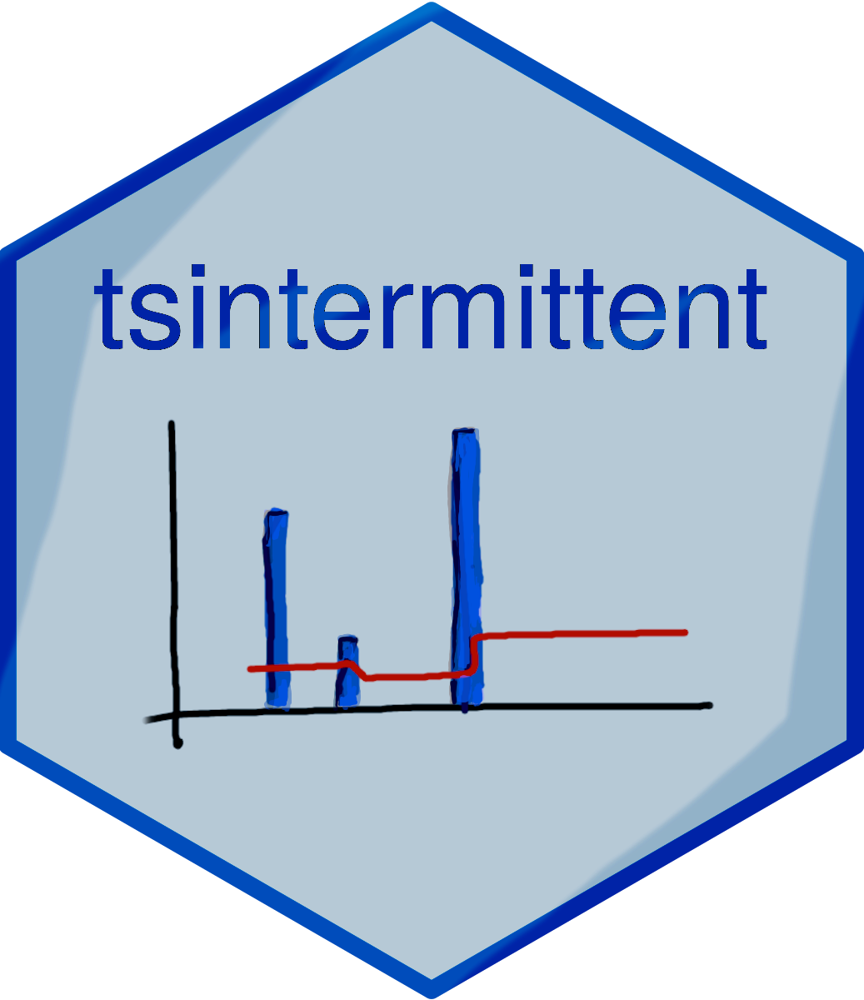

Intermittent demand forecasting package for R (tsintermittent)
=======

Development repository for the tsintermittent package for R.
Stable version can be found at: https://cran.r-project.org/web/packages/tsintermittent/index.html

Functions and wrappers for producing intermittent demand forecasts for R, including Croston's method and its variants, TSB, iMAPA, classification of intermittent series, and empirical quantiles of the demand over the lead time. The parameters and initial values of all methods can be optimised using cost functions designed for intermittent demand. See `vignette("tsintermittent")` for an introduction.

## Installation

To install the development version from GitHub use:

> if (!require("remotes")){install.packages("remotes")}

> remotes::install_github("trnnick/tsintermittent", build_vignettes=TRUE)

## Functions

### Forecasting methods

- `crost()`: Croston's method, SBA, and SBJ.
- `crost.ma()`: Croston-style moving averages.
- `tsb()`: TSB method.
- `sexsm()`: Simple exponential smoothing.
- `imapa()`: iMAPA, combining forecasts from multiple temporal aggregation levels.
- `data.frc()`: Forecasting multiple series with a single call.

### Lead time quantiles

- The input `probs` of the forecasting methods: quantiles of the demand over the lead time and safety stock, when fitting a model.
- `lt.dist()`: Quantiles of the demand over the lead time, for a fitted model with any lead time and probabilities, or for forecasts produced otherwise.

### Methods for fitted models

- `print()`, `summary()`, `coef()`, and `fitted()`.
- `plot()`: per-period and lead time views of the forecasts, plus additional views for iMAPA.
- `forecast()`: point forecasts for any horizon, optionally for new data.
- The input `model` of the forecasting methods, or `model.fit` of `imapa()`: a fitted model applied to new data without optimisation.

### Classification

- `idclass()`: Classification of intermittent demand series, to select between Croston's method, SBA, and SES.
- `print()` and `plot()` of the classification.

### Utilities and data

- `crost.decomp()`: Croston decomposition into non-zero demand and intervals.
- `simID()`: Simulation of intermittent demand series.
- `ts.data1` and `ts.data2`: Example series.

## References

- Kourentzes, N. (2014). On intermittent demand model optimisation and selection. *International Journal of Production Economics*, 156, 180-190. [doi:10.1016/j.ijpe.2014.06.007](https://doi.org/10.1016/j.ijpe.2014.06.007)
- Petropoulos, F., and Kourentzes, N. (2015). Forecast combinations for intermittent demand. *Journal of the Operational Research Society*, 66(6), 914-924. [doi:10.1057/jors.2014.62](https://doi.org/10.1057/jors.2014.62)
- Saoud, P., Kourentzes, N., and Boylan, J. E. (2022). Approximations for the lead time variance: A forecasting and inventory evaluation. *Omega*, 110, 102614. [doi:10.1016/j.omega.2022.102614](https://doi.org/10.1016/j.omega.2022.102614)
- Svetunkov, I., Kourentzes, N., and Killick, R. (2024). Multi-step estimators and shrinkage effect in time series models. *Computational Statistics*, 39(3), 1203-1239. [doi:10.1007/s00180-023-01377-x](https://doi.org/10.1007/s00180-023-01377-x)

_Happy forecasting!_
